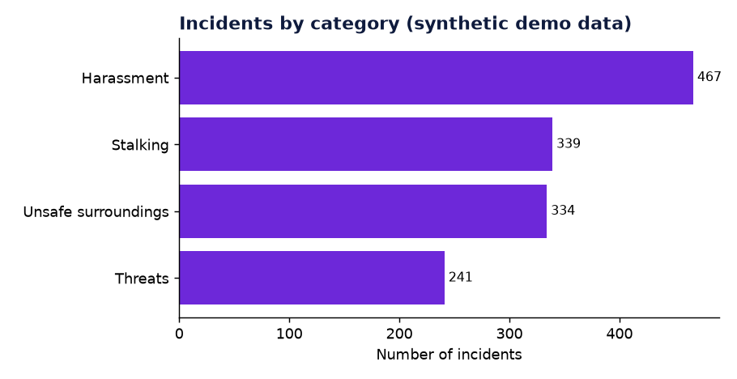
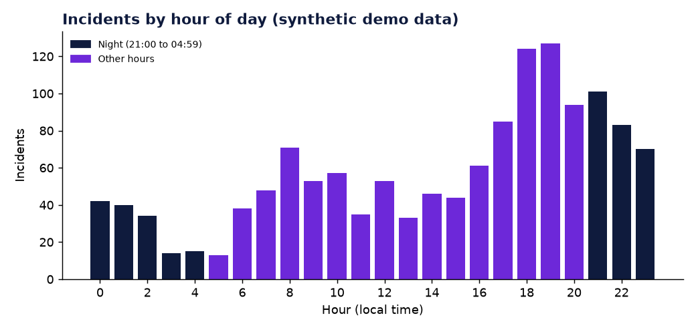
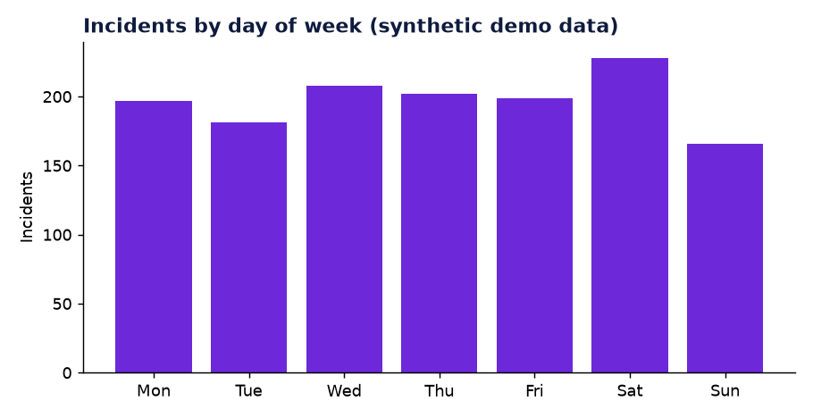
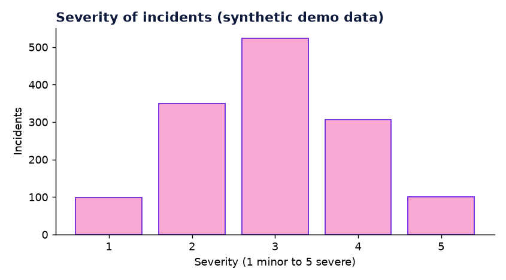
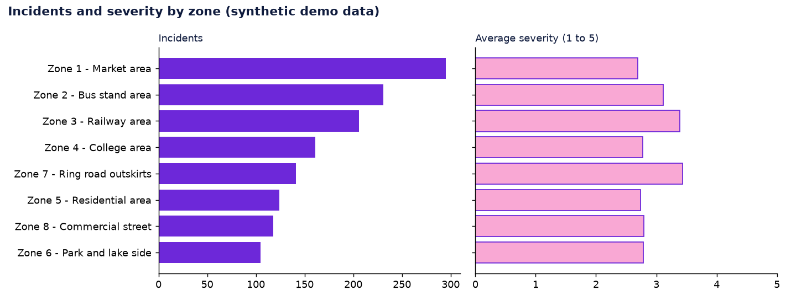
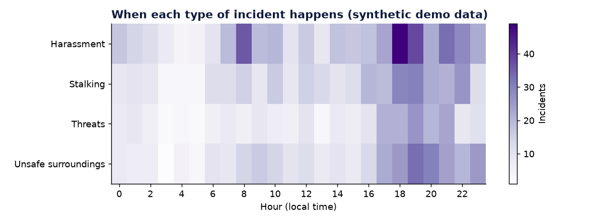
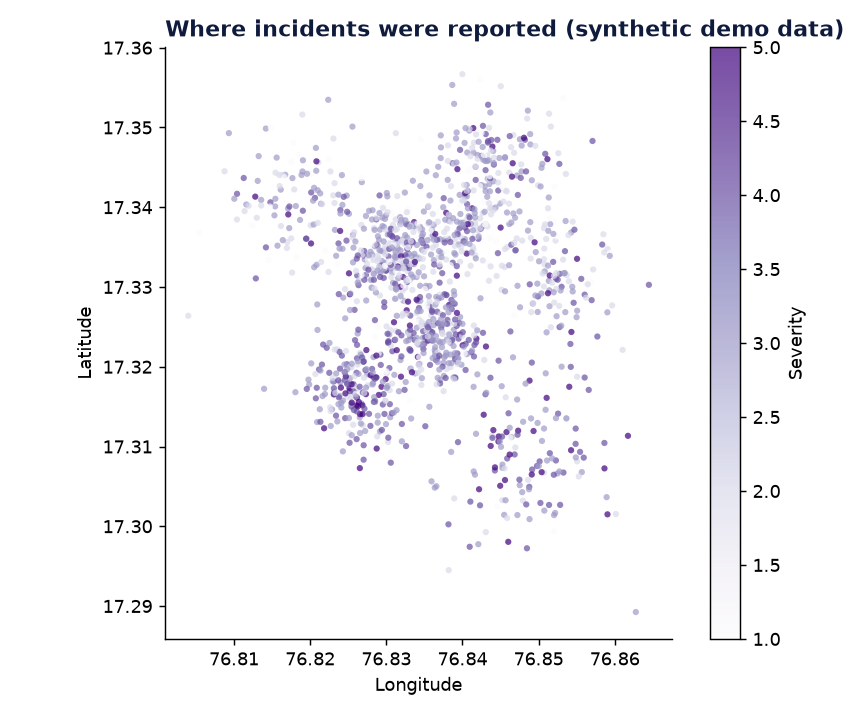

# SafeRadar AI - exploratory data analysis

> **SYNTHETIC DATA.** Every row was generated by the developer for testing. The patterns below were written into the generator, so they show assumptions, not real events. They say nothing about how safe any real place is.

- Rows analysed: **1381**
- Period covered: 2025-12-20 to 2026-11-14
- Average severity: 2.97 / 5
- Busiest hour: 19:00
- Busiest weekday: Saturday
- Share of incidents at night (21:00 to 04:59): 28.9%
- Share on weekends: 28.5%

## Incidents by category

- Harassment: 467
- Stalking: 339
- Threats: 241
- Unsafe surroundings: 334

## Incidents by zone (with average severity)

- Demo Zone 1 - Market area: 295 incidents, average severity 2.69
- Demo Zone 2 - Bus stand area: 231 incidents, average severity 3.11
- Demo Zone 3 - Railway area: 206 incidents, average severity 3.39
- Demo Zone 4 - College area: 161 incidents, average severity 2.78
- Demo Zone 7 - Ring road outskirts: 141 incidents, average severity 3.44
- Demo Zone 5 - Residential area: 124 incidents, average severity 2.73
- Demo Zone 8 - Commercial street: 118 incidents, average severity 2.8
- Demo Zone 6 - Park and lake side: 105 incidents, average severity 2.78

## Charts

